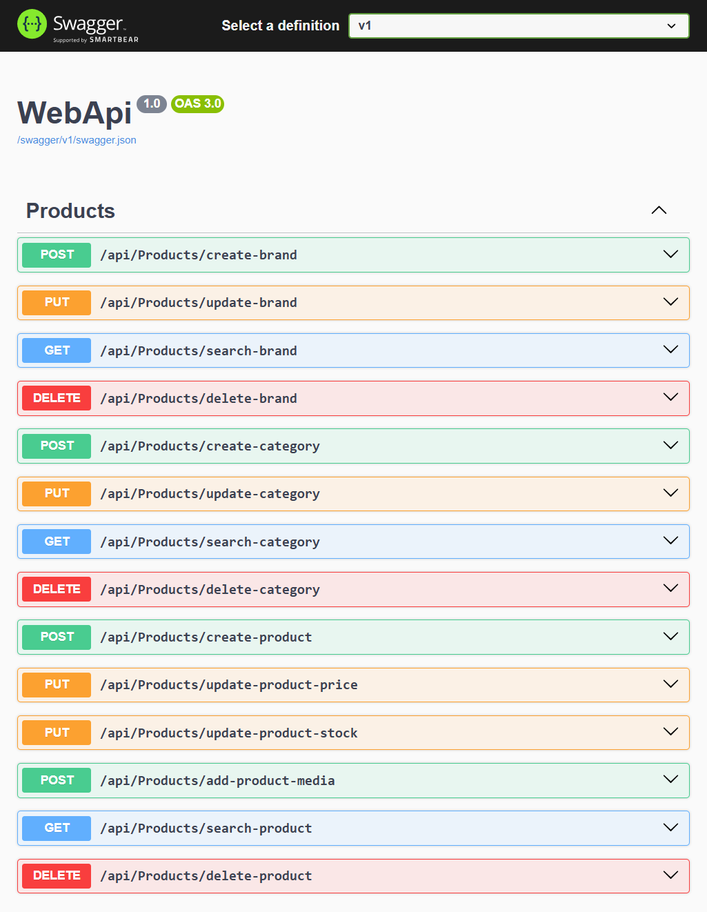
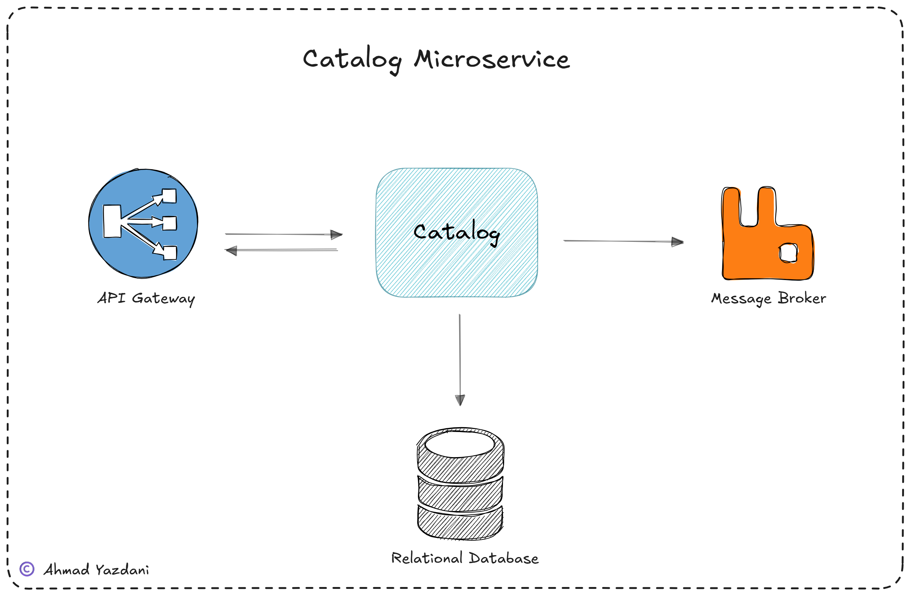

# 🛍️ Catalog Service

A microservice for managing product catalog data in an e-commerce platform, including products, brands, categories, pricing, stock, and product media.

The Catalog Service exposes RESTful APIs for managing catalog information and communicates with other microservices through **RabbitMQ**. When relevant product data changes, the service publishes messages to the message broker, allowing downstream services, such as the Search Service, to react to those changes asynchronously. 
<br/>


## ✨ Features

- 📦 **Product Management:** Create and search products, update prices and stock, and manage product media.
- 🏷️ **Brand Management:** Create, search, and update product brands.
- 🗂️ **Category Management:** Create, search, and update product categories.
- 📨 **Asynchronous Communication:** Publish messages to RabbitMQ when relevant product state changes.
- 🌐 **RESTful API:** Expose HTTP endpoints for catalog operations.
- 💾 **Data Persistence:** Store catalog data using Entity Framework Core and database migrations.
- 🛡️ **Domain Rules:** Enforce business constraints, including valid product prices and non-negative stock quantities.
- 🧪 **Unit Testing:** Test application handlers across product, brand, and category operations.
<br/>


## 📚 API Documentation

The service provides interactive API documentation through Swagger UI, allowing developers to explore endpoints and test requests.


<br/>


## 🏗️ Architecture and Workflow

The Catalog Service follows a layered architecture that separates API handling, application logic, domain rules, and infrastructure concerns.
<br/>
### 🔄 Product Update Workflow

When a product update request is received, the service processes the operation, persists the changes to the database, and publishes a message through RabbitMQ so other microservices can consume the event.



This asynchronous communication helps decouple the Catalog Service from downstream consumers. For example, the Search Service can consume product change events to keep its search index synchronized with the catalog.
<br/>

## 🗃️ Project Structure

The solution is organized into separate projects, each with a distinct responsibility.

```text
src/
├── ApplicationService/
│   └── Products/
│       └── Handlers/
│           ├── BrandHandlers/
│           ├── CategoryHandlers/
│           └── ProductHandlers/
├── Domain/
│   ├── Features/
│   │   └── Products/
│   │       ├── Commands/
│   │       ├── Contracts/
│   │       ├── DTOs/
│   │       ├── Entities/
│   │       ├── Exceptions/
│   │       └── ValueObjects/
│   └── Shadred/
├── Infrastructure/
│   ├── Migrations/
│   └── Persistence/
│       └── Products/
└── WebApi/
    ├── Controllers/
    ├── Extensions/
    ├── Filters/
    └── Middlewares/

tests/
└── Catalog.UnitTests/
    └── HandlerTests/
        └── Products/
            ├── BrandHandlers/
            ├── CategoryHandlers/
            └── ProductHandlers/
```
<br/>

### 🧩 Project Responsibilities

| Project | Responsibility |
|---|---|
| `WebApi` | Exposes HTTP endpoints through controllers and configures API behavior, Swagger, and exception handling. |
| `ApplicationService` | Implements application use cases through command and query handlers. |
| `Domain` | Defines business entities, commands, DTOs, repository contracts, value objects, and domain rules. |
| `Infrastructure` | Implements persistence, repositories, Entity Framework Core configurations, and database migrations. |
| `Catalog.UnitTests` | Contains unit tests for application handlers and catalog operations. |
<br/>
## 🧰 Technologies

- 💻 C# / .NET
- 🌐 ASP.NET Core Web API
- 🗄️ Entity Framework Core
- 🐇 RabbitMQ
- 📖 Swagger / OpenAPI
- 🧪 Unit Testing
<br/>

-------------------
<br/>
## 🚀 Getting Started

### ✅ Prerequisites

Before running the service, ensure you have the following installed and configured:

- A compatible .NET SDK
- A supported relational database
- RabbitMQ, if message publishing is enabled in the application configuration
<br/>


### ⚙️ Configuration

Configure the database connection string and any required messaging settings in the application's configuration files or environment variables.

Review the configuration in:

- `src/WebApi/appsettings.json`
- `src/WebApi/appsettings.Development.json`

> 🔐 **Security note:** Avoid committing credentials, passwords, or other secrets to the repository.

<br/>
### ▶️ Run the Application

From the repository root, restore dependencies and build the solution:

```bash
dotnet restore Catalog.sln
dotnet build Catalog.sln
```

Run the Web API:

```bash
dotnet run --project src/WebApi/WebApi.csproj
```

Once the application is running, open the Swagger UI endpoint configured for the application to explore the available API operations.

